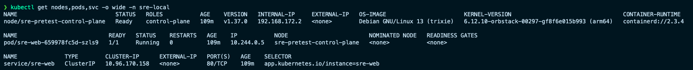
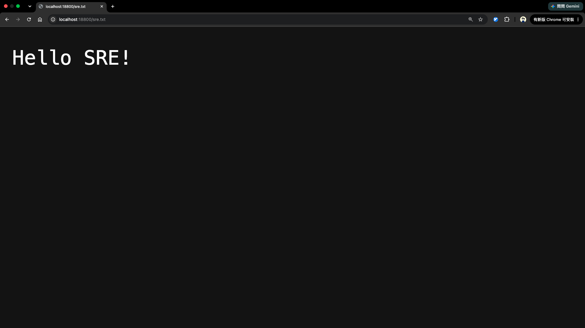

# Gamania SRE Pretest

GKE cluster on GCP via Terraform, a custom nginx image, a Helm chart, and a GitHub Actions pipeline that deploys it to alpha, beta, staging and production.

```
.
├── app/                  # Dockerfile + sre.txt
├── deploy/chart/         # Helm chart, values-{alpha,beta,staging,production,local}.yaml
├── infra/terraform/      # GKE, VPC, Artifact Registry, Cloud Armor
├── .github/workflows/    # ci.yaml, terraform-apply.yaml, deploy.yaml
└── images/               # screenshots
```

## Result





## Build and run

**Infrastructure (Q1)**

```bash
cd infra/terraform && cp terraform.tfvars.example terraform.tfvars  # set project_id
terraform init && terraform plan && terraform apply
```

**Image (Q2)** — `app/Dockerfile` copies `sre.txt` (`Hello SRE!`) into the nginx web root:

```bash
docker build -t sre-nginx ./app
docker run --rm -p 8080:80 sre-nginx && curl http://localhost:8080/sre.txt
```

**Deploy (Q3)** — on GKE the pipeline adds `--set-string` for the image tag and Cloud Armor policy:

```bash
kind create cluster --config deploy/kind-config.yaml
docker build -t sre-nginx:local ./app && kind load docker-image sre-nginx:local
helm upgrade --install sre-web deploy/chart -f deploy/chart/values-local.yaml
kubectl get nodes,pods,svc -o wide
```

## CI/CD (Q4)

- `ci.yaml` — on every PR: `terraform validate`, `helm lint/template`, `docker build`; on push to `main` it pushes the image tagged with the commit SHA to Artifact Registry (Workload Identity Federation, no keys).
- `terraform-apply.yaml` — manual dispatch behind a confirmation flag: `terraform plan` → `apply`, gated by the `infrastructure` GitHub Environment.
- `deploy.yaml` — manual dispatch with environment and image tag: reads Terraform outputs, checks the image exists, then `helm upgrade --install` into `sre-<env>`.

## Multi-environment GitOps (Q5)

Git holds one chart plus a committed `values-<env>.yaml` per environment; promotion redeploys the **same immutable image tag** to the next environment, so only the values file changes, never the artifact. Each environment maps to a GitHub Environment (optional reviewer gates) that picks its values file and namespace (`sre-alpha` … `sre-production`), and `git diff` on the values files shows any drift.

## Linking Terraform to Helm (Q6)

Terraform publishes resource names as outputs and the deploy job injects them at render time — `terraform output -raw cloud_armor_policy_name` becomes `--set-string cloudArmor.policyName=...` (`deploy.yaml:51-76`). This keeps Terraform authoritative for infrastructure and Helm for releases; alternatives like the `helm_release` provider or a ConfigMap couple the two more tightly for little gain.

## AI assistance disclosure

Terraform, the Helm chart and the CI/CD workflows were written with partial AI assistance (OpenCode and Codex); the Dockerfile and prose were written by hand. Prompt texts were not retained — their intent: scaffold Terraform for GKE with Artifact Registry and Cloud Armor, generate the Helm chart behind a GCE ingress, build the validate/publish/deploy pipeline, and explain GitOps promotion plus Terraform-to-Helm value wiring.
